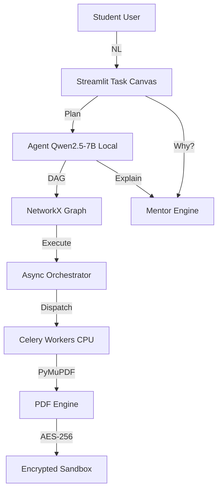

# PDFMate AI — Buildathon 2026 Submission

## One-Line Pitch

PDFMate AI is the first local-first, agentic document mentor that runs
entirely on your local GPU with 8 GB+ VRAM. You describe what you need in plain English.
The AI draws a visual workflow you can edit, teaches you why each step
matters, and executes it offline on consumer hardware. No uploads. No
subscriptions. No cloud.

## Hardware

| Component | Spec |
|---|---|
| System | Consumer Hardware (On-Device) |
| GPU | Local GPU with 8 GB+ VRAM |
| RAM | System Memory |
| CPU | Multi-Core Processor |
| Storage | Local NVMe |

## Quick Start

```bash
# 1. Activate environment
source .venv/bin/activate

# 2. Run all tests
pytest tests/ -v --cov=src --cov-fail-under=80

# 3. Launch the full demo
make demo

# 4. In a second terminal, watch GPU usage
make demo-gpu

# 5. Open browser
# http://localhost:8501
```

## Demo Script (5 Minutes)

| Beat | Time | Action |
|---|---|---|
| 1. Hook | 0:00 | Show Privacy Lock: "GPU Running - 0% Cloud". Disable Wi-Fi. |
| 2. Input | 0:30 | Type: "Merge 4 notes, redact ID, summarize, compress <10MB" |
| 3. Canvas | 1:00 | 7 nodes render. Visual DAG. Not a black box. |
| 4. Edit | 1:30 | Click Compress node. Change JPEG2000 to Flate. Click Why? |
| 5. Execute | 2:00 | Hit Run. Parallel nodes. GPU at 60-70%. |
| 6. Score | 3:00 | Literacy Score: 72/100. Pedagogical feedback. |
| 7. Close | 3:30 | Show audit trail. 7 immutable rows. Nothing left this machine. |

## Architecture



## Security

- Zero network egress (internal Docker bridge / no external calls)
- AES-256-GCM encryption at rest
- PBKDF2 key derivation from hardware fingerprint
- SQLite audit trail with BEFORE UPDATE/DELETE abort triggers
- Fail-closed: container exits if GGUF models missing

## Differentiation

| Capability | ChatPDF | Adobe AI | PDFgear | PDFMate AI |
|---|---|---|---|---|
| Chat with PDF | Yes | Yes | Yes | Yes |
| Execute PDF ops | No | Cloud | Local | Local Agent |
| Local LLM | No | No | No | Yes |
| Visual Workflow | No | No	| No | Yes |
| Teaches User | No | No | No | Yes |
| Scanned Note VLM | Partial | Cloud | No | Local |
| Fully Offline | No | No | No | Yes |
