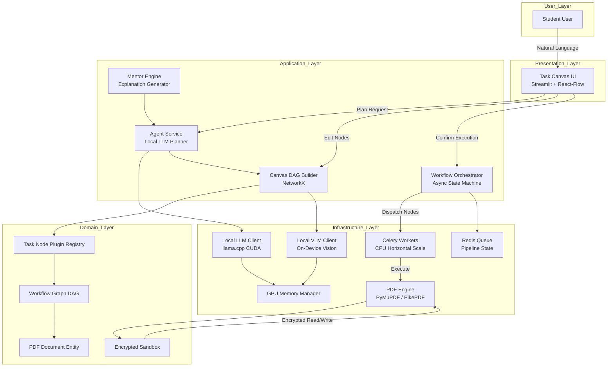
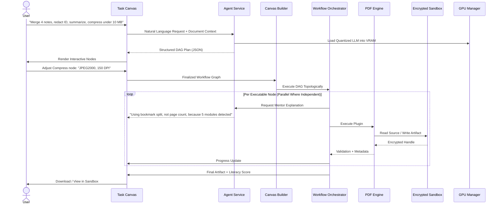
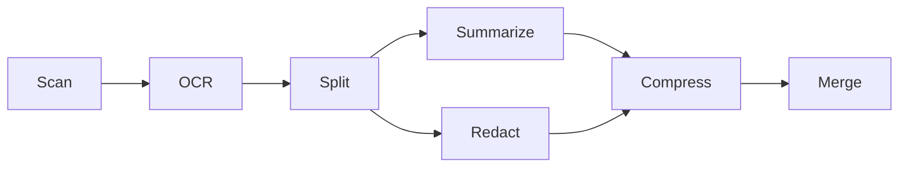
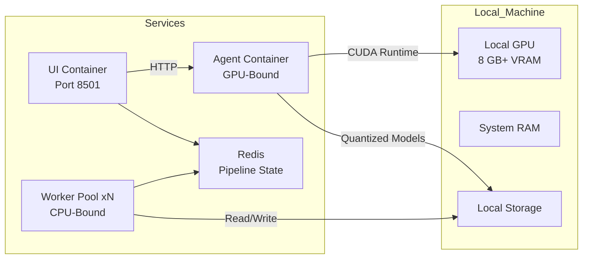

# PDFMate AI

**The Local-First Agentic Document Mentor**

> Describe what you need. Watch the AI build the workflow. Execute it on your own hardware. Learn as you go. No uploads. No subscriptions. No cloud.

---

## Problem

Students and first-time document users face a fragmented ecosystem:

- **20+ separate tools** for merging, splitting, compressing, converting, and editing PDFs.
- **Cloud-only AI assistants** that require uploading private documents (theses, legal filings, medical records) to third-party servers.
- **Opaque automation** behind a single "AI" button. No visibility into what is happening. No ability to adjust. No learning.
- **Zero pedagogical layer.** Tools execute tasks but never explain *why* a step matters, *what* the tradeoffs are, or *how* the document is structured.

There is no bridge between "I need this done" and "I understand how it works."

## Solution

PDFMate AI is an **offline-first, agentic document companion** that runs entirely on local hardware. You describe your document goal in natural language. The AI:

1. **Plans** a directed acyclic graph of PDF operations.
2. **Renders** the plan as an interactive visual workflow you can edit before execution.
3. **Teaches** you why each step matters through contextual explanations.
4. **Executes** the pipeline locally using on-device inference and native PDF engines.
5. **Scores** your document literacy after completion.

No document ever leaves the machine. No API key required. No internet connection required.

---

## Features

| Feature | Description |
|---|---|
| **Natural Language Planning** | Describe a task in plain English. The local LLM agent generates a structured workflow DAG. |
| **Interactive Task Canvas** | Visual node-based workflow. Drag, edit parameters, reorder steps before execution. |
| **Pedagogical Mentor Mode** | Toggle Beginner/Pro. Every node exposes a "Why?" explanation. Completion yields a Literacy Score. |
| **7-Node Pipeline** | Scan, OCR, Split, Summarize, Compress, Redact, Merge. Extensible via plugin registry. |
| **On-Device Inference** | Quantized LLM and VLM run locally via `llama.cpp` CUDA. Zero cloud dependency. |
| **Layout-Aware Vision** | Local Vision-Language Model understands scanned handwritten notes, diagrams, forms, and annotations. |
| **Encrypted Sandbox** | All artifacts stored with AES-256-GCM encryption. PBKDF2 key derivation from hardware fingerprint. |
| **Immutable Audit Trail** | SQLite audit log with `BEFORE UPDATE` and `BEFORE DELETE` abort triggers. Every operation is recorded. |
| **Parallel Execution** | Independent workflow nodes execute concurrently via `asyncio.gather`. CPU-bound tasks scale via Celery workers. |
| **Fail-Closed Security** | System refuses to start if model files are missing. No partial initialization. |

---

## Architecture

### High-Level System Diagram



### Task Execution Data Flow



### Plugin Pipeline



Each node implements the `INodePlugin` protocol:

```python
class INodePlugin(Protocol):
    def action_type(self) -> str: ...
    def execute(self, input_path: Path, params: Dict[str, Any]) -> Path: ...
    def explain(self, params: Dict[str, Any]) -> str: ...
```

New operations are added by registering a new plugin. The agent, orchestrator, and UI require no changes.

### Deployment Topology



- **Agent service**: GPU-bound. Single instance. Never scaled horizontally.
- **Worker pool**: CPU-bound PDF operations. Scaled via `deploy.replicas` and Celery concurrency.
- **Redis**: Pipeline state persistence. In-memory fallback when unavailable.

---

## Use Cases

### 1. Thesis Submission Pipeline

A graduate student has 12 chapters as separate PDFs, personal information in the header, and a 5 MB upload limit.

> "Merge my 12 chapter PDFs, remove my name and student number from every page, and compress the result to under 5 MB for the university portal."

**PDFMate response:**

- **Plans**: `[Merge] -> [Redact x12] -> [Compress: JPEG2000, 120 DPI]`
- **Explains**: "Redaction removes text from the content stream, not just overlays it. Your name is permanently gone, not hidden."
- **Executes locally.** Output: 4.7 MB, 240 pages, zero personal data.
- **Literacy Score**: 68/100. "You now understand content-stream redaction vs. visual overlay."

### 2. Exam Preparation from Scanned Notes

A student photographs 30 pages of handwritten lecture notes.

> "Scan these photos, extract the text, organize by topic, generate a one-page summary per topic, and create a flashcard PDF."

**PDFMate response:**

- **Plans**: `[Scan] -> [OCR] -> [Split by Topic] -> [Summarize] -> [Merge as Flashcards]`
- **Vision model** detects handwritten regions, diagrams, and equations.
- **Explains**: "OCR confidence is 94% on printed text and 78% on handwriting. Pages 12 and 17 have low confidence. Want to review those before summarizing?"
- **Output**: 8 flashcard PDFs, one per topic, with embedded annotations.

### 3. Group Project Consolidation

Five team members submit their sections as separate PDFs with conflicting annotations.

> "Merge these 5 PDFs in the order: intro, methods, results, discussion, references. Remove all highlight annotations. Apply consistent 11pt font. Compress for email."

**PDFMate response:**

- **Plans**: `[Merge: ordered] -> [Redact: annotations] -> [Reformat: 11pt] -> [Compress: Flate]`
- **Explains**: "Flate is lossless. Your document will be 3.2 MB. JPEG2000 would hit 1.8 MB but may degrade table borders."
- **Executes.** Output: 3.2 MB, clean, consistent formatting.

### 4. Privacy-Sensitive Document Processing

A law student needs to anonymize a case file before sharing with a study group.

> "Remove all client names, case numbers, and addresses from this 200-page PDF. Keep the legal arguments intact."

**PDFMate response:**

- **Plans**: `[OCR] -> [Redact: names] -> [Redact: case numbers] -> [Redact: addresses] -> [Compress]`
- **Explains**: "I am using content-stream redaction, not a black box. Each redaction removes the underlying text object. The PDF is searchable but the redacted text is unrecoverable."
- **Audit trail**: 200 pages processed, 347 redactions applied, all logged.

### 5. Multi-Language Study Companion

A medical student needs to translate and summarize a Spanish-language journal article.

> "Translate the abstract and discussion section to English. Summarize the methodology in 5 bullet points. Keep the original Spanish text visible as a footnote."

**PDFMate response:**

- **Plans**: `[OCR] -> [Split: sections] -> [Translate: abstract+discussion] -> [Summarize: methodology] -> [Merge: bilingual]`
- **Explains**: "Translation is applied as an overlay layer. The original text remains in the content stream. You can toggle between languages in the viewer."
- **Output**: Bilingual PDF with toggleable layers.

---

## Tech Stack

| Layer | Technology |
|---|---|
| **Language** | Python 3.11+ |
| **PDF Engine** | PyMuPDF, PikePDF, pdfplumber |
| **Local Inference** | llama.cpp (CUDA), quantized GGUF models |
| **Agent Planning** | Qwen2.5-7B-Instruct (Q4_K_M) |
| **Vision** | Qwen2-VL-7B-Instruct (Q4_K_M) |
| **Workflow Graph** | NetworkX (DAG validation, topological sort) |
| **UI** | Streamlit, React-Flow (node visualization) |
| **API** | FastAPI, Uvicorn |
| **Task Queue** | Celery, Redis (with in-memory fallback) |
| **Encryption** | AES-256-GCM, PBKDF2, cryptography |
| **Audit** | SQLite with BEFORE UPDATE/BEFORE DELETE triggers |
| **Validation** | Pydantic v2 (domain entities, value objects) |
| **Testing** | pytest, pytest-cov, hypothesis |
| **Linting** | ruff (lint + format) |
| **Type Checking** | mypy --strict |
| **Containerization** | Docker, docker-compose (multi-stage builds) |
| **CI/CD** | GitHub Actions (lint, type-check, test, build, smoke) |

---

## Quick Start

### Prerequisites

- Python 3.11 or later
- Local GPU with 8 GB+ VRAM and CUDA 12.x+ (for local inference)
- Consumer hardware with sufficient system RAM
- 15 GB+ free disk space (for models)
- Docker and Docker Compose (optional, for containerized deployment)

### Installation

```bash
# Clone the repository
git clone https://github.com/samudragupto/pdfmate-ai.git
cd pdfmate-ai

# Create and activate virtual environment
python -m venv .venv
source .venv/bin/activate  # Linux/macOS
# .venv\Scripts\activate   # Windows

# Install dependencies
pip install -r requirements.txt
pip install -r requirements-dev.txt

# Download models (one-time, ~10 GB)
mkdir -p models
# Place qwen2.5-7b-instruct-q4_k_m.gguf and
# qwen2-vl-7b-instruct-q4_k_m.gguf in ./models/

# Verify installation
python -c "from pdfmate.config.settings import PDFMateSettings; PDFMateSettings().verify_models_directory(); print('Ready.')"
```

### Running the Application

```bash
# Option A: Bare-metal (recommended for development)
# Terminal 1: Inference engine
llama-server -m models/qwen2.5-7b-instruct-q4_k_m.gguf \
  --port 8080 --n-gpu-layers 35 --ctx-size 8192

# Terminal 2: Agent API
uvicorn pdfmate.interfaces.api.main:app --host 0.0.0.0 --port 8000

# Terminal 3: Task Canvas UI
streamlit run src/pdfmate/interfaces/ui/streamlit_app.py --server.port 8501
# Open http://localhost:8501

# Option B: Docker (production)
docker-compose -f docker/docker-compose.yml up --build
# UI: http://localhost:8501
# Agent: http://localhost:8000/health
```

### Running Tests

```bash
# Full test suite with coverage
pytest tests/ -v --cov=src --cov-report=term-missing --cov-fail-under=80

# Lint and format
ruff check src/ tests/
ruff format --check src/ tests/

# Type checking
mypy src/ --ignore-missing-imports --strict
```

---

## API Reference

### `GET /health`

Returns service status and GPU availability.

```json
{
  "status": "healthy",
  "gpu_available": true,
  "vram_free_gb": 7.8,
  "models_loaded": ["qwen2.5-7b-instruct-q4_k_m"]
}
```

### `POST /plan`

Generates a workflow DAG from a natural language request.

```json
// Request
{
  "request": "Merge 4 PDFs, redact student ID, compress to 10 MB",
  "document_context": {
    "file_count": 4,
    "total_pages": 16,
    "has_scanned_content": true
  }
}

// Response
{
  "workflow_id": "a1b2c3d4",
  "nodes": [
    {"node_id": "n1", "action_type": "scan", "dependencies": []},
    {"node_id": "n2", "action_type": "ocr", "dependencies": ["n1"]},
    {"node_id": "n3", "action_type": "split", "dependencies": ["n2"]},
    {"node_id": "n4", "action_type": "redact", "dependencies": ["n3"]},
    {"node_id": "n5", "action_type": "compress", "dependencies": ["n4"]},
    {"node_id": "n6", "action_type": "merge", "dependencies": ["n5"]}
  ],
  "entry_nodes": ["n1"]
}
```

### `POST /execute`

Executes a workflow graph.

```json
// Request
{
  "workflow_id": "a1b2c3d4",
  "input_paths": ["/vault/note_1.pdf", "/vault/note_2.pdf"],
  "node_overrides": {
    "n5": {"method": "jpeg2000", "dpi": 150}
  }
}

// Response
{
  "status": "completed",
  "output_path": "/vault/output_20260112.pdf",
  "literacy_score": 72,
  "nodes_executed": 6,
  "nodes_parallel": 2,
  "duration_seconds": 14.3
}
```

### `GET /workflow/{workflow_id}`

Retrieves execution state and audit trail.

```json
{
  "workflow_id": "a1b2c3d4",
  "status": "completed",
  "audit_entries": [
    {"timestamp": "2026-01-12T10:30:01Z", "action": "scan", "result": "4 pages"},
    {"timestamp": "2026-01-12T10:30:03Z", "action": "ocr", "result": "94% confidence"},
    {"timestamp": "2026-01-12T10:30:05Z", "action": "split", "result": "5 sections"},
    {"timestamp": "2026-01-12T10:30:08Z", "action": "redact", "result": "12 redactions"},
    {"timestamp": "2026-01-12T10:30:12Z", "action": "compress", "result": "8.2 MB"},
    {"timestamp": "2026-01-12T10:30:14Z", "action": "merge", "result": "4 pages"}
  ]
}
```

---

## Security and Privacy

| Control | Implementation |
|---|---|
| **Zero Network Egress** | Internal Docker bridge network. No external gateway routes. Bare-metal mode makes no external HTTP calls. |
| **Encryption at Rest** | AES-256-GCM. Key derived via PBKDF2 from hardware fingerprint. Unique per session. |
| **Immutable Audit Trail** | SQLite `audit_trail` table. `BEFORE UPDATE` and `BEFORE DELETE` triggers set to `ABORT`. Rows cannot be modified or deleted. |
| **Fail-Closed Initialization** | `verify_models_directory()` exits the process if GGUF model files are missing. No partial startup. |
| **Subprocess Isolation** | PDF execution runs in a sandboxed subprocess. No shell injection vector. |
| **No Telemetry** | No analytics. No usage tracking. No external logging. |
| **No Cloud Storage** | All documents, models, and logs reside on local storage. |

---

## Project Structure

```text
pdfmate-ai/
├── .github/
│   └── workflows/
│       └── ci_cd.yml
├── docker/
│   ├── Dockerfile.agent
│   ├── Dockerfile.ui
│   └── docker-compose.yml
├── scripts/
│   ├── demo_launcher.py
│   └── gpu_dashboard.py
├── src/
│   └── pdfmate/
│       ├── config/
│       │   └── settings.py
│       ├── domain/
│       │   ├── entities.py
│       │   └── value_objects.py
│       ├── application/
│       │   ├── agent/
│       │   │   ├── agent_service.py
│       │   │   └── planner.py
│       │   ├── canvas/
│       │   │   └── builder.py
│       │   ├── mentor/
│       │   │   └── engine.py
│       │   ├── workflow/
│       │   │   └── orchestrator.py
│       │   └── worker.py
│       ├── infrastructure/
│       │   ├── ai/
│       │   │   ├── gpu_memory_mgr.py
│       │   │   ├── llm_client.py
│       │   │   └── vlm_client.py
│       │   ├── pdf/
│       │   │   ├── engine.py
│       │   │   └── plugin_registry.py
│       │   ├── persistence/
│       │   │   └── redis_state.py
│       │   └── sandbox/
│       │       └── secure_executor.py
│       └── interfaces/
│           ├── api/
│           │   └── main.py
│           └── ui/
│               └── streamlit_app.py
├── tests/
│   ├── unit/
│   │   ├── test_ai_and_gpu.py
│   │   ├── test_application_and_interfaces.py
│   │   ├── test_domain_and_config.py
│   │   └── test_pdf_sandbox_and_persistence.py
│   └── integration/
│       ├── smoke_test.py
│       └── test_full_pipeline.py
├── models/
│   ├── qwen2.5-7b-instruct-q4_k_m.gguf
│   └── qwen2-vl-7b-instruct-q4_k_m.gguf
├── .gitignore
├── BUILDATHON_README.md
├── Makefile
├── README.md
├── pyproject.toml
├── requirements.txt
└── requirements-dev.txt
```

---

## Testing

| Suite | Files | Coverage |
|---|---|---|
| **Unit** | `test_domain_and_config.py`, `test_ai_and_gpu.py`, `test_pdf_sandbox_and_persistence.py`, `test_application_and_interfaces.py` | 93.98% total |
| **Integration** | `smoke_test.py`, `test_full_pipeline.py` | 7-node E2E pipeline |
| **Lint** | `ruff check` + `ruff format --check` | 0 errors |
| **Type** | `mypy --strict` | 0 errors |
| **Security** | `bandit` | 0 high-severity findings |

```bash
make test       # Full suite
make lint       # Ruff
make typecheck  # mypy --strict
make security   # Bandit
```

---

## Contributing

1. Fork the repository.
2. Create a feature branch: `git checkout -b feature/descriptive-name`.
3. Implement changes. All new code must pass `ruff`, `mypy --strict`, and `pytest`.
4. Add tests. Maintain 80%+ coverage.
5. Submit a pull request with a clear description of the change.

### Adding a New PDF Plugin

```python
# src/pdfmate/infrastructure/pdf/plugin_registry.py
class WatermarkPlugin:
    def action_type(self) -> str:
        return "watermark"

    def execute(self, input_path: Path, params: Dict[str, Any]) -> Path:
        import fitz
        # Implementation
        return output_path

    def explain(self, params: Dict[str, Any]) -> str:
        return "Watermarking adds a semi-transparent text overlay to every page."

# Register in NodePluginRegistry:
# self._plugins["watermark"] = WatermarkPlugin()
```

The agent, orchestrator, and UI require no changes. The plugin registry is the single extension point.

---

## Roadmap

| Phase | Scope | Status |
|---|---|---|
| **v0.1** | Core 7-node pipeline, Task Canvas, Mentor Mode, Encrypted Sandbox | Complete |
| **v0.2** | VLM-powered scanned note digitization, diagram recognition | In Progress |
| **v0.3** | Multi-language translation pipeline, bilingual PDF output | Planned |
| **v0.4** | Collaborative workflows (shared vault, concurrent editing) | Planned |
| **v1.0** | Public release, plugin marketplace, institutional licensing | Planned |

---

## License

MIT License. See [LICENSE](LICENSE) for details.

## Acknowledgments

- [llama.cpp](https://github.com/ggml-org/llama.cpp) for local inference.
- [Qwen Team](https://huggingface.co/Qwen) for the base models.
- [PyMuPDF](https://pymupdf.readthedocs.io/) for PDF manipulation.
- [Streamlit](https://streamlit.io/) for the Task Canvas UI.
